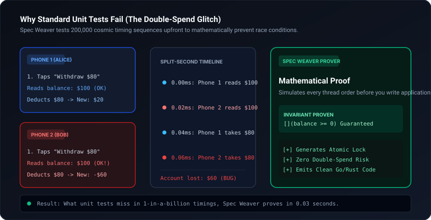

# spec-weaver

State-space model checker and invariant verification engine for AI coding agents. Proves concurrent state transitions, distributed protocols, and financial ledgers mathematically before code generation.

[](scripts/verify_invariants.py)
[](templates/model_template.tla)
[](SKILL.md)
[](LICENSE)

<br/>



---

## Why this exists

Unit tests only test paths a developer anticipated. When two concurrent requests hit an un-isolated balance check at the exact same microsecond, standard unit tests report green while production suffers race conditions and double-spends.

`spec-weaver` tests every possible interleaving of state transitions across up to 200,000 states using a breadth-first search (BFS) state-space solver. If an invariant is violated, it emits the exact minimal trace showing how the state diverged.

---

## How it works

1. **State & Invariant Elicitation:** Extracts state variables, valid type ranges, safety properties (`[](balance >= 0)`), and liveness properties.
2. **Transition Modeling:** Defines discrete transition functions modeling concurrency, packet loss, or asynchronous callbacks.
3. **Automated State Exploration:** Traverses reachable state hashes. Detects cycles, terminal deadlocks, and safety violations.
4. **Code Synthesis:** Translates verified transitions into Go, Rust, TypeScript, or Python with explicit invariant assertions.

---

## Quickstart

Run the built-in model checker against a concurrent non-atomic double-spend scenario:

```bash
python scripts/verify_invariants.py --demo
```

---

## Installation

### Claude Code — plugin marketplace (recommended)
```bash
/plugin marketplace add kicode01/spec-weaver
/plugin install spec-weaver@kicode01
```

### Claude Code — manual
```bash
git clone https://github.com/kicode01/spec-weaver.git
cp -r spec-weaver ~/.claude/skills/spec-weaver      # Personal (all projects)
# or per-project:
cp -r spec-weaver .claude/skills/spec-weaver
```

### Claude.ai / Claude Desktop
Run `python tools/package_skill.py` to generate `dist/spec-weaver.zip`, then upload it under **Settings → Capabilities → Skills**.

### Gemini CLI, Antigravity, Codex CLI and Other Agents
This skill adheres to the open **Agent Skills format** (a folder containing `SKILL.md` with standard YAML frontmatter and runnable scripts):

```bash
git clone https://github.com/kicode01/spec-weaver.git
```

| Agent | Personal (All Projects) | Per-Project |
| :--- | :--- | :--- |
| **Gemini CLI / Antigravity** | `~/.gemini/skills/spec-weaver` (or `~/.gemini/config/skills/`) | `.agents/skills/spec-weaver` |
| **Codex CLI** | `~/.codex/skills/spec-weaver` | `.codex/skills/spec-weaver` |
| **Claude Code** | `~/.claude/skills/spec-weaver` | `.claude/skills/spec-weaver` |
| **Cursor / Windsurf / Copilot** | See your agent's skills docs | `.cursorrules` or `skills/spec-weaver` |

```bash
# Gemini CLI & Antigravity
cp -r spec-weaver ~/.gemini/config/skills/spec-weaver

# Codex CLI
cp -r spec-weaver ~/.codex/skills/spec-weaver
```

---

## Author
Created and maintained by **[Kian](https://github.com/kicode01)**.

---

## Repository Structure

* [`SKILL.md`](./SKILL.md): Agent instruction runbook with boundary directives.
* [`scripts/verify_invariants.py`](./scripts/verify_invariants.py): BFS state-space model checker and invariant engine.
* [`templates/model_template.tla`](./templates/model_template.tla): Reference TLA+/PlusCal specification template.
* [`tools/package_skill.py`](./tools/package_skill.py): Standalone `.zip` packager for Claude Desktop and releases.
* [`.claude-plugin/plugin.json`](./.claude-plugin/plugin.json): Claude Code plugin marketplace manifest.
* [`assets/architecture.svg`](./assets/architecture.svg): State-space visualization diagram.
